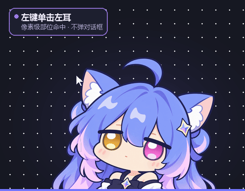
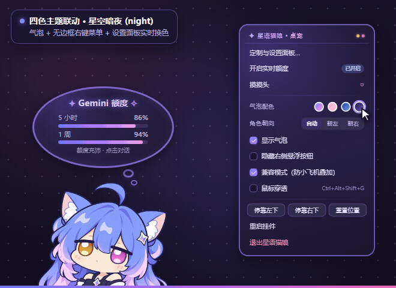
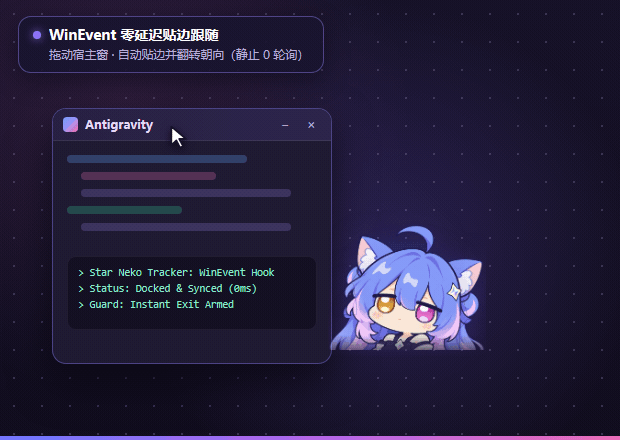
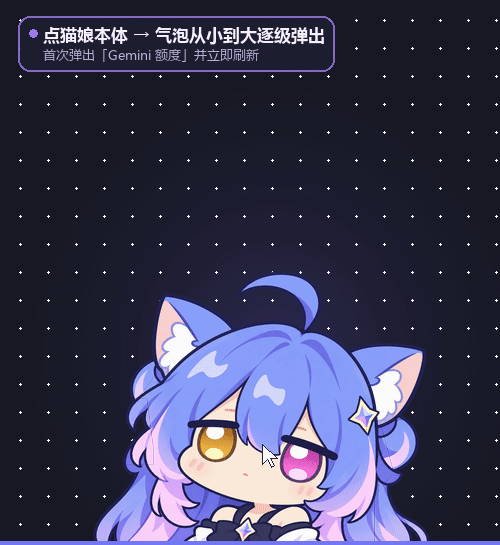
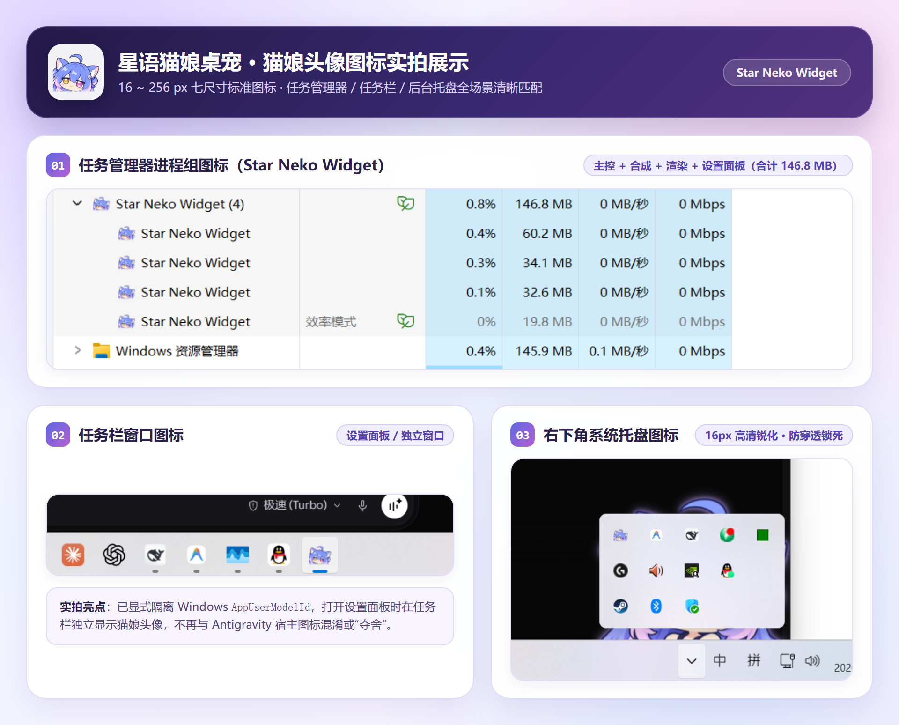

# 星语猫娘 Neko · v1.11（53 层分层微动桌宠）

A 53-layer split-sprite desktop catgirl companion for Google Antigravity (Windows, unofficial fork).

基于开源项目 [Monokumakuki/Antigravity-Star-Suite](https://github.com/Monokumakuki/Antigravity-Star-Suite)（`star-suite-widget v0.2.14`）深度二次开发的 Windows Electron 桌宠改版：将原版静态单图立绘无损拆分为 **53 层准 Live2D 动态立绘**，带来像素级耳朵/呆毛/侧键互动、防误触「摸摸头」、四色自绘避让菜单、2× 超采样防糊 Q 弹气泡、实时 Gemini 额度与单轮 Token 播报、GPU/防小飞机双渲染管线，以及零轮询伴随启停。

[效果预览](#效果预览) · [快速安装](#快速安装windows-10--11) · [核心功能与交互](#核心功能与交互) · [性能与底层架构](#性能与底层架构) · [更新日志](#更新日志) · [开源与素材声明](#开源与素材权利声明) · [English](#english)

---

## 效果预览

| 左右耳 & 呆毛独立按压 / 侧键双耳齐压 | 53 层耳动波浪 & AI 工作态星晶光边 | 发冠搓揉防误触 & 摸摸头完整演出 |
| :---: | :---: | :---: |
|  |  |  |

| 四色主题三端同步联动 | 窗口零延迟贴边跟随 & 关闭秒退 | 本体联动气泡 & 单轮 Token 播报 |
| :---: | :---: | :---: |
|  |  |  |

---

## 快速安装（Windows 10 / 11）

> 仓库内**不含任何预编译 `.exe` / `.dll`**；安装脚本会调用 Windows 自带的 `.NET Framework 4 csc.exe` 在本机 1 秒现场编译原生组件，无需安装 Visual Studio 或 .NET SDK。

### 方式一：AI 一键安装（推荐）

仓库根目录内置了给 AI Agent 使用的标准化安装与验收规程 [`AGENTS.md`](AGENTS.md)（含环境自检、硬依赖校验、国内镜像安装、防误覆盖保护与逐项验收）。下载仓库后，直接在 Antigravity / Claude Code / Codex 中发送：

> 请阅读仓库根目录的 `AGENTS.md`，严格按规程帮我安装并验收这个桌宠。

### 方式二：PowerShell 手动安装

在仓库根目录打开 PowerShell：

```powershell
# 推荐：安装独立版（自动编译原生助手 + 自动配置国内 Electron 镜像，不碰原版）
powershell -ExecutionPolicy Bypass -File ".\一键安装并启动.ps1" -Standalone

# 如需替换本机已安装的原版 AntigravityStarSuite（必须显式传 -Force，覆盖前自动备份为 app.bak-<时间戳>）
powershell -ExecutionPolicy Bypass -File ".\一键安装并启动.ps1" -Force
```

> 安装说明：
> - **防误覆盖保护**：检测到本机已装原版 `AntigravityStarSuite` 且未传参数时，脚本会主动中止并提示在 `-Standalone` 与 `-Force` 间二选一；
> - **国内镜像自动加速**：独立模式需 Node.js `>= 18`，默认配置 `ELECTRON_MIRROR=https://npmmirror.com/mirrors/electron/`（尊重已有环境变量），失败时自动清缓存并切 `https://registry.npmmirror.com` 重试一次；
> - **分步运行**：也可手动执行 `powershell -ExecutionPolicy Bypass -File ".\编译原生助手.ps1"` → `cd app` → `npm install` → `npm start`。

### 开启实时 Gemini 额度与 AI 发光（可选）

实时额度与 AI 工作态星晶光边依赖 Antigravity 的本机调试端口（`%APPDATA%\Antigravity\DevToolsActivePort`），**不开启不影响贴边跟随、53 层动效、摸摸头与日志 Token 播报**。开启方式任选其一：

1. **菜单一键开启（最简单）**：右键猫娘 → 点击 **「开启实时额度」**，自动带 `--remote-debugging-port=0` 重开宿主，并可一键绑定桌面/开始菜单快捷方式（保留 Antigravity 原生图标）。
2. **伴随启动器**：编译完成后直接双击 `LaunchAntigravityWithWidget.exe` 打开 Antigravity（自动找寻宿主、开端口、拉起桌宠，关闭 Antigravity 后即刻伴随退出；特殊安装路径可设环境变量 `ANTIGRAVITY_EXE`）。
3. **手动参数**：在 `Antigravity` 快捷方式「目标」末尾添加 ` --remote-debugging-port=0`。

---

## 核心功能与交互

### 1. 53 层无损动态立绘与状态演出

- **原画零改动**：`frames/` 原图完整保留，脸部与眼睛零修改，静止叠合像素误差为 `0`；`layers/` 全部 53 张图层在预乘 Alpha 空间无损缩裁至 `686×573`（保留 `2×+` 超采余量，磁盘体积 `-65%`、纹理内存 `-75%`）。
- **常态灵动微动**：每 `7–14s` 随机触发 5 种猫耳动作（左耳 / 右耳 / 双耳 / 左先右后 / 右先左后，双侧小发包 `bunL/bunR` 同步 Q 弹跟随）；头顶呆毛每 `3.5–6.5s` 慢晃、右下发丝每 `5–9s` 微风轻摆、每 `3.2–7s` 自动眨眼 `150ms`。
- **微醺腮红 & 星晶薄光边**：互动、摸摸头、彩蛋或单轮完成时触发 `1.8s → 2.0s → 2.4s` 渐显淡退腮红；AI 工作期间 `1.4s` 缓亮轮廓薄紫光边与头/胸饰星辉，结束后 `1.6s` 缓灭。

### 2. 像素级拆分鼠标交互 & 防误触「摸摸头」

| 区域 | 操作 | 交互效果 |
|---|---|---|
| **左右猫耳** | 左键单击 / 长按 | `137×115` 像素级命中图（扣除头部与发包前景，兼容左右镜像）；仅对应单耳与同侧发包压下回弹，**不压本体、不拖拽、不弹气泡** |
| **头顶呆毛** | 左键单击 / 长按 | 仅呆毛独立压弯、松手阻尼弹性回摆，不触发本体与气泡 |
| **悬停猫娘** | **鼠标前 / 后侧键** | **前侧键（`button=4`）→ 视觉左耳、后侧键（`button=3`）→ 视觉右耳**（支持双侧键齐压双耳）；仅监听桌宠自身窗口消息，零全局钩子、不干扰游戏 |
| **头顶发冠 / 刘海** | **快速左右搓揉** | 限定在发冠与刘海弧线区，`900ms` 内完成两折快速往返（`≥ 550 px/s`）触发 `1.8s` 摸摸头演出（腮红 + 爱心 + 歪头蹭蹭 + 得意表情 + 双耳错拍 + 呆毛发丝连摆）；慢晃、单向划过或划过眼睛/脸颊零误触（被动 `12s` 冷却；右键菜单「摸摸头 ♡」无冷却随时触发） |
| **猫娘本体** | 左键单击 / 拖拽 | 气泡关闭时单击压扁回弹并逐级弹出「Gemini 额度」气泡；气泡开启时连同气泡同步 Q 弹压扁；按住自由拖动并贴边吸附、自动翻转朝向 |
| **头顶气泡** | 悬停 / 左键单击 | 悬停暂停自动收起；单击在 **「Gemini 额度」→「星语猫娘」随机台词 → 逐级收起** 间循环 |
| **全局交互区** | 滚轮 / 右键 / 快捷键 | 滚轮切页或缩放（`140–360px`）；右键呼出自绘快捷菜单；`Ctrl+Alt+G` 唤回设置、`Ctrl+Alt+Shift+G` 一键解除鼠标穿透 |

<p align="center">
  
</p>

### 3. 四色自绘菜单、清晰防糊气泡与三端猫娘图标

- **四套主题三端实时联动**：内置 **星晶蓝紫（`crystal`）**、**樱粉浅暖（`sakura`）**、**经典蓝白（`ocean`）**、**星空暗夜（`night`）**，切换时头顶气泡、无边框右键菜单与定制设置面板同步换色。
- **智能避让 & 可拖拽右键菜单**：弹出时根据猫娘停靠位置自动向左右外侧避让（绝不遮挡角色头部），支持按住顶部标题栏自由拖拽位置，无外扩脏影（暗色背景下边缘纯净透明），关闭 `12s` 后自动销毁释放内存。
- **静止清晰文字 + 2× 超采样按压防糊**：对话框文字与进度条在静止时完全固定不晃眼；气泡卡片采用内部 `2×` 超采样光栅化，按压猫娘/气泡时壳与文字同步 Q 弹压扁，在高分屏（`125%/150%/200%` DPI）与 GPU 硬件加速下依然锐利不发糊。
- **七尺寸猫娘头像 & 进程正名**：重制 `16 / 24 / 32 / 48 / 64 / 128 / 256px` 七尺寸锐化 `app-icon.ico`，配合独立 `AppUserModelId` 与原生 `BrandExe.cs` 贴牌工具，在任务管理器（`Star Neko Widget` / `Star Neko Tracker` / `Star Neko Guard`）、Windows 任务栏与右下角系统托盘三端清晰呈现。

<p align="center">
  
</p>

<p align="center">
  
</p>

---

## 性能与底层架构

- **双渲染管线（默认 GPU + 防小飞机兼容模式）**：默认 GPU 硬件加速保留全部 30fps 灵动特效；若开启 MSI Afterburner / RTSS 全局 OSD 出现帧率字叠在猫娘上，在菜单或设置页勾选 **「兼容模式（防小飞机叠加）」** 即可热重启切为纯 CPU 软渲染，彻底免疫叠加并降至 `0 MB` 显存。
- **深度休眠与自愈看门狗**：宿主最小化或不可见时自动休眠暂停动画与定时器；事件驱动 `verifySurfaceOnce()` 看门狗在唤醒、切屏、DPI 变化或 GPU 重启后自动巡检黑框/空白/冻结并无感自愈。
- **轻量化低打扰追踪器（`ForegroundHost.cs`）**：窗口贴边跟随采用进程外异步 `WinEvent` 钩子（不注入任何进程，不影响反作弊），位置与拖拽钩子定向绑定至 Antigravity 单进程 `PID`（无全系统 `0x8004` 高频重排钩子），检测到全屏游戏（`SHQueryUserNotificationState`）时自动卸载宿主钩子进入深度低耗等待；贴边跟随为硬依赖，缺失时明确弹窗提示不降级。
- **低开销 I/O、CDP 复用与伴随秒退**：会话日志采用 `fs.watch` + 偏移增量尾读（单轮完成播报总 Token 与步数、`ask_question` 触发等待确认提醒），账本快照增加版本缓存消除高频排序；`SharedHostCdp` 单 WebSocket 连接复用与 `WeakRef` 服务缓存；关闭 Antigravity 后守护进程在 `1.5–3s` 内即刻清理全部桌宠进程，无后台残留；托盘图标 + 全局快捷键彻底防止鼠标穿透锁死。
- **纯净音效**：仅内置 4 套可追溯 CC0 / MIT 安全音色（活跃音轨管理，连续点击不打断前音），支持在设置面板自由导入本地 `.wav / .mp3 / .ogg / .m4a` 自定义音效。

---

## 更新日志

### v1.11（2026-11-25 · 稳定性与体验精修版）
- **气泡视觉精修**：移除头顶气泡内文字的周期性上下晃动，保持阅读清晰稳定；气泡卡片改用内部 `2×` 超采样光栅化，完整保留按压时壳与字同步 Q 弹压扁，彻底消除 GPU 硬件加速与高 DPI 下按压文字发糊的问题。
- **原生追踪器防打扰与减负（`ForegroundHost.cs`）**：将 `LOCATIONCHANGE`（`0x800B`）与拖拽钩子缩窄至 Antigravity 单宿主 `PID`，移除全系统高频 `0x8004` 重排钩子，新增全屏游戏自动卸载宿主钩子机制与 PID 进程名缓存，并清理无效 Z-order 遍历与 `/warn:4` 编译警告（实测追踪进程 CPU 趋近 `0%`、独占内存降幅 `~65%`）。
- **边界 Bug 全量修复**：
  - 修复菜单主动「摸摸头 ♡」未同步渲染端冷却计时导致 12s 内搓头把冷却误延长至 ~24s 的问题，并支持连续点击重播歪头蹭蹭动画；
  - 修复带 `--software-render` / `--force-gpu` 参数启动时无法从菜单切换兼容模式的问题；
  - 修复无宿主状态下热重启挂件 / 切兼容模式 30 秒后被守护进程误杀的问题；
  - 修复拖动右键菜单标题栏途中 `Alt+Tab` 失焦导致菜单滞留屏幕的问题；
  - 修复等待确认气泡未尊重「直到主动收起（`0ms`）」设置的问题；
  - 为 `UsageLedger.getSnapshot()` 增加版本缓存，消除每次状态广播的全量历史排序开销。

### v1.1（2026-11-25 · 性能重制、摸摸头与自绘菜单版）
- 53 层立绘预乘 Alpha 无损缩裁至 `686×573`（磁盘 `-65%`、纹理 `-75%`），合并网络辅助进程，引入默认 GPU + 防小飞机兼容模式双管线、不可见休眠与黑框/冻结自愈看门狗。
- 新增「摸摸头」全套动态演出与发冠防误触搓揉手势；全面正名「星语猫娘」，推出四色三端联动无边框自绘右键菜单（自动侧边避让、标题栏拖拽、无暗底脏影、闲置 `12s` 自动释放）。
- 重制 7 尺寸猫娘 `app-icon.ico`，新增 `BrandExe.cs` / `WidgetBrandCarrier.cs` 与右下角托盘防穿透锁死；新增一键「开启实时额度」、开始菜单快捷方式自愈及宿主关闭即刻伴随退出。
- 提升 4 套 CC0/MIT 公开音色清晰度与多音轨并发表现。

### v1.0
- 完成 53 层动态立绘拆分、左右耳/呆毛像素级独立按压、鼠标侧键控耳、AI 工作态星晶光边与基础贴边跟随。

---

## 开源与素材权利声明

- **软件代码**：继承上游 [LICENSE](LICENSE)（MIT License，Copyright (c) 2026 Monokumakuki），本仓库二次开发代码同样遵循 MIT。第三方依赖说明见 [app/NOTICE.md](app/NOTICE.md)。
- **美术素材**：详见 [app/ASSETS.md](app/ASSETS.md)。软件 MIT 许可**不适用于角色立绘图片与第三方标识**；角色设计参考署名 **ZipZipPipe**。角色图层使用已获原作者 Monokumakuki 许可（2026-11-22），仅用于本项目非商用展示与运行，不授予独立再许可。**如任何权利人对图片展示或包含存在异议，请通过本仓库 Issues 联系，将立即下架或调整。**
- **音效素材**：本公开版仅保留上游可记录许可的 4 套 CC0 / MIT 安全音色（已移除全部第三方游戏/未验证授权音频）；用户可在设置面板中自行导入本地音频。

---

## English

**Star Neko Widget (`v1.11`)** is an unofficial 53-layer split-sprite desktop catgirl companion for Google Antigravity on Windows, forked from [Monokumakuki/Antigravity-Star-Suite](https://github.com/Monokumakuki/Antigravity-Star-Suite).

- **Highlights**: 53 lossless pre-multiplied layers (`686×573`), pixel-accurate ear & ahoge press, mouse side-button ear control, crown-only anti-misclick headpat (`≥ 550 px/s`), 4-theme synced frameless context menu with smart avoidance & header drag, `2×` supersampled crisp squish bubbles, GPU + RTSS-safe software dual rendering pipeline, host-PID-scoped `WinEvent` tracking (auto-suspends during fullscreen games), and instant companion exit when Antigravity closes.
- **Requirements**: Windows 10/11 x64, Node.js ≥ 18 (standalone mode), built-in .NET Framework 4 (`csc.exe`, zero prebuilt `.exe`/`.dll` in repo).
- **Quick start**: `powershell -ExecutionPolicy Bypass -File ".\一键安装并启动.ps1" -Standalone`
- **AI installation**: point your coding agent to [`AGENTS.md`](AGENTS.md).
- **License**: Code is MIT; character artwork is **not** MIT and is used with the original author's permission for non-commercial use only.
