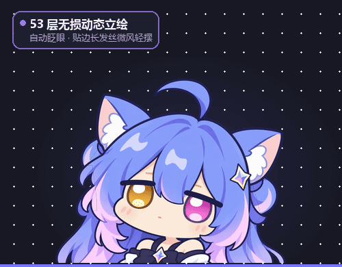
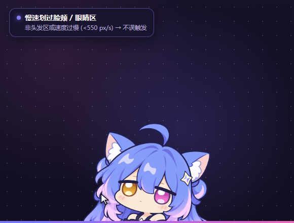
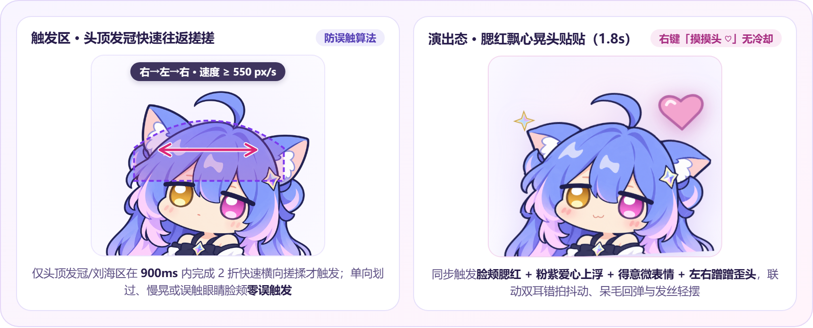
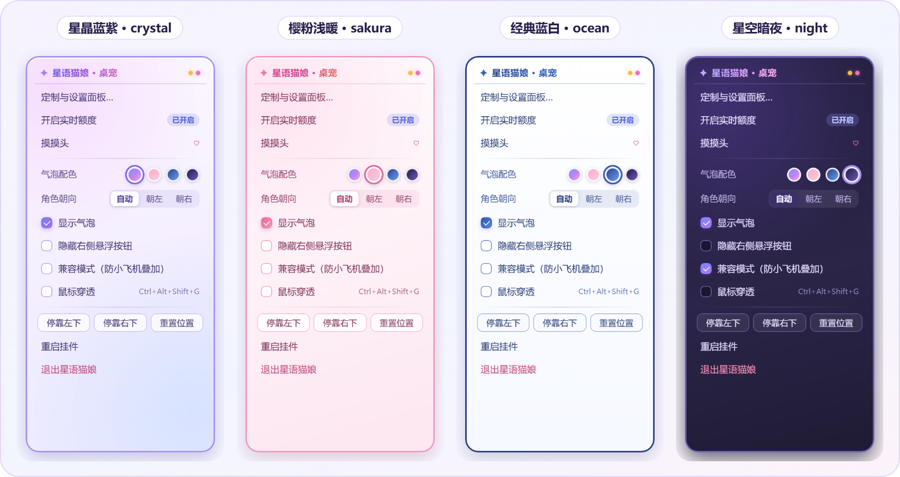

# 星语猫娘 Neko · Antigravity 桌面宠物（v1.12）

An unofficial split-sprite desktop catgirl companion for Google Antigravity on Windows.

基于 [Monokumakuki/Antigravity-Star-Suite](https://github.com/Monokumakuki/Antigravity-Star-Suite)（`star-suite-widget v0.2.14`）二次开发的 Windows Electron 桌宠改版。将原版静态单图立绘拆分为多图层部件与序列帧，支持像素级分部位互动、防误触「摸摸头」、四套主题自绘菜单与弹窗、`2×` 超采样气泡、实时 Gemini 额度与本地会话 Token 播报、GPU / 软渲染双模式切换，以及随宿主窗口贴边跟随与无强杀安全重开。

[功能预览](#功能预览) · [快速安装](#快速安装) · [交互方式](#交互方式) · [特性与架构说明](#特性与架构说明) · [更新日志](#更新日志) · [许可与版权](#许可与版权) · [English](#english)

---

## 功能预览

> 以下动图与 `07` / `08` 为功能示意渲染图。真机运行时猫娘默认停靠在 Antigravity **窗口客户区内部**（默认右下角内缩 `18px`），部分细节（如正常联网时额度进度条下方无附加文字、单轮完成仅弹跳星闪不切表情、摸摸头仅飘爱心、右键菜单无外扩投影）以实机运行和下文说明为准。

| 左右耳 & 呆毛独立按压 / 侧键控耳 | 常态耳动波浪 & AI 工作态星晶光边 | 发冠搓揉防误触 & 摸摸头演出 |
| :---: | :---: | :---: |
|  |  |  |

| 四套主题联动 | 窗口贴边跟随 & 伴随退出 | 本体联动气泡 & 单轮 Token 播报 |
| :---: | :---: | :---: |
|  |  |  |

---

## 快速安装

**环境要求**：Windows 10 / 11 x64，系统自带 `.NET Framework 4`（`csc.exe`）；独立模式需要 Node.js `>= 18`。仓库内**不包含任何预编译 `.exe` / `.dll`**，安装脚本会在本机现场编译原生组件。

### 方式一：交给 AI Agent 安装（推荐）

仓库根目录附带了标准化安装与验收文档 [`AGENTS.md`](AGENTS.md)。下载仓库后，直接在 Antigravity / Claude Code / Codex 中发送：

> 请阅读仓库根目录的 `AGENTS.md`，按规程帮我安装并验收这个桌宠。

### 方式二：PowerShell 手动安装

在仓库根目录打开 PowerShell：

```powershell
# 推荐：独立模式（不触碰已安装的原版 AntigravityStarSuite）
powershell -ExecutionPolicy Bypass -File ".\一键安装并启动.ps1" -Standalone

# 替换原版模式（需已装原版 AntigravityStarSuite，覆盖前自动备份为 app.bak-<时间戳>）
powershell -ExecutionPolicy Bypass -File ".\一键安装并启动.ps1" -Force
```

> 也可分步运行：`powershell -ExecutionPolicy Bypass -File ".\编译原生助手.ps1"` → `cd app` → `npm install` → `npm start`。
> 独立模式默认设置 `ELECTRON_MIRROR=https://npmmirror.com/mirrors/electron/`（尊重你已有的环境变量），安装失败会自动清缓存并切 `https://registry.npmmirror.com` 重试一次。如果检测到本机已装原版且未传参数，脚本会直接中止并提示二选一，不会误覆盖。

#### 两种安装模式的区别

| 对比项 | `-Standalone`（独立模式，推荐） | `-Force`（替换原版模式） |
|---|---|---|
| 是否需要 Node.js | 需要（`>= 18`） | 不需要（复用原版 `StarWidget.exe` 壳） |
| 是否改动原版目录 | 否 | 会先备份 `resources\app` 再替换 |
| 任务管理器进程名与图标 | 显示为 `Electron`（托盘与设置窗任务栏为猫娘图标） | 经 `BrandExe` 贴牌为 `Star Neko Widget` 与猫娘图标 |
| 安装后自动挂起伴随守护 | 否（需后续经 `LaunchAntigravityWithWidget.exe` 启动或菜单开启实时额度） | 若 Antigravity 正在运行，直接经 `--attach` 挂起守护 |

### 开启实时 Gemini 额度（可选）

实时读取 **5 小时 / 1 周 Gemini 剩余额度** 以及基于宿主按钮状态的即时工作态发光，依赖 Antigravity 的本机调试端口（`%APPDATA%\Antigravity\DevToolsActivePort`）。**不开启该端口也能正常使用贴边跟随、分部位互动、摸摸头与本地日志 Token 播报**（AI 工作态发光也会按本地会话日志回退触发，仅额度显示 `—`，且可在设置页手动记录）。

任选以下一种方式开启：

1. **右键菜单一键开启（最省事）**：右键猫娘 → 点击 **「开启实时额度」**，在主题确认窗中选择「重开并设为默认伴随启动」或「仅本次重开」。重启过程**绝不强杀进程**：先发优雅关闭请求最多等待 `15s`；若 Antigravity 开启了后台运行缩进托盘，再弹出托盘退出指引窗等待最多 `60s` 自动接管；超时则放弃重开、原样保留当前窗口。
2. **使用随包启动器**：编译完成后双击 `LaunchAntigravityWithWidget.exe` 启动 Antigravity，自动附带 `--remote-debugging-port=0` 并拉起桌宠，关闭 Antigravity 后自动清理桌宠进程（非默认安装路径可设环境变量 `ANTIGRAVITY_EXE`）。
3. **手动加参数**：在 Antigravity 快捷方式的「目标」末尾添加 ` --remote-debugging-port=0`。

---

## 交互方式

| 区域 | 操作 | 效果 |
|---|---|---|
| **左右猫耳** | 左键单击 / 长按 | `137×115` 像素级命中图（扣除头部与小发包前景，兼容左右镜像）；仅对应单耳与同侧小发包下压回弹，**不压本体、不拖拽、不弹气泡** |
| **头顶呆毛** | 左键单击 / 长按 | 呆毛独立压弯、松手阻尼回摆，不触发本体与气泡 |
| **悬停猫娘** | 鼠标前 / 后侧键 | **前侧键（`button=4`）→ 视觉左耳、后侧键（`button=3`）→ 视觉右耳**，支持双键齐压双耳；仅监听桌宠自身窗口消息，无全局鼠标钩子 |
| **头顶发冠 / 刘海** | 快速左右搓揉 | 限定发冠与刘海弧线区，`900ms` 内完成两折三段横向快速搓揉（默认 `220px` 宽下需 `≥ 550 px/s`）触发 `1.8s` 摸摸头演出（腮红 + 爱心 + 歪头蹭蹭 + 得意表情 + 双耳错拍 + 呆毛发丝连摆）；慢晃或划过脸颊眼睛不误触（被动 `12s` 冷却；右键菜单「摸摸头 ♡」无冷却） |
| **猫娘本体** | 左键单击 / 拖拽 | 气泡关闭时单击压扁回弹并逐级弹出额度气泡；气泡开启时与气泡同步 Q 弹压扁；按住可在 **Antigravity 窗口客户区内**自由拖动、贴边吸附并自动翻转朝向 |
| **头顶气泡** | 悬停 / 左键单击 | 悬停暂停自动收起；单击在 **「Gemini 额度」→「星语猫娘」随机台词 → 逐级收起** 间循环 |
| **全局快捷键与菜单** | 滚轮 / 右键 / 快捷键 | 滚轮切换气泡页或缩放大小（`140–360px`）；右键呼出四色自绘菜单；`Ctrl+Alt+G` 唤回设置面板、`Ctrl+Alt+Shift+G` 一键解除鼠标穿透 |

<p align="center">
  
</p>

---

## 特性与架构说明

### 立绘分层与常态微动
- **多图层序列帧拆分**：`frames/` 保留上游 `1372×1146` 原图留档；运行时加载 `layers/` 下的 **12 个叠加 DOM 层**与 **44 张活跃预乘 Alpha 部件帧**（缩放至 `686×573`，相对默认 `220px` 宽度保留 `2×+` 显示余量，降低内存与磁盘占用）。
- **常态与状态表现**：每 `7–14s` 随机触发 5 种猫耳动作（左 / 右 / 双耳 / 左先右后 / 右先左后，双侧小发包同步跟随），呆毛每 `3.5–6.5s` 慢晃、右下发丝每 `5–9s` 轻摆、每 `3.2–7s` 自动眨眼 `150ms`；互动或单轮完成时触发 `1.8s → 2.0s → 2.4s` 渐显淡退腮红；AI 工作期间轮廓紫光边与星辉 `1.4s` 缓亮、结束后 `1.6s` 缓灭。

### 四色主题、自绘菜单与清晰气泡
- **四套主题同步联动**：内置 **星晶蓝紫（`crystal`）**、**樱粉浅暖（`sakura`）**、**经典蓝白（`ocean`）**、**星空暗夜（`night`）**，切换时同步作用于头顶气泡、无边框右键菜单、定制设置面板与「开启实时额度」确认弹窗。
- **避让与可拖拽菜单**：弹出时按停靠侧自动避开角色头部，按住顶部标题栏可自由拖动，透明边缘无外扩脏影，关闭 `12s` 后自动销毁释放内存。
- **防糊 Q 弹气泡**：静止时文字与进度条完全固定不晃动；气泡卡片采用内部 `2×` 超采样（`zoom: 2` + `scale(0.5)`），按压同步压扁时在高 DPI 与 GPU 加速下仍保持清晰。
- **七尺寸图标与托盘防锁死**：内置 `16–256px` 七尺寸 `app-icon.ico` 与独立 `AppUserModelId`，托盘常驻方便随时调出设置或解除穿透。

<p align="center">
  
</p>

<p align="center">
  
</p>

### 渲染模式与底层机制
- **GPU 默认模式 vs 兼容模式（防小飞机叠加）**：
  - 默认启用 GPU 硬件加速：耳朵 / 呆毛 / 腮红 / 光边按 `~60fps` 驱动，待机呼吸与思考摇摆按 `30fps` 驱动。
  - 若开启 MSI Afterburner / RTSS 全局 OSD 导致帧率字叠在猫娘上，在菜单或设置页勾选 **「兼容模式（防小飞机叠加）」** 即可热重启切为纯 CPU 软渲染（`0 MB` 显存、彻底免疫 OSD 叠加）；为把空闲 CPU 压到最低，兼容模式下部位动效降至 `~32fps`，且**关闭待机呼吸与思考/警告时的整体摇摆**。
- **窗口追踪器（`ForegroundHost.cs`）**：
  - 采用进程外异步 `WinEvent` 钩子（不注入任何进程），位置与拖拽钩子定向绑定至 Antigravity 单进程 PID（无全系统 `0x8004` 重排钩子）；静止时 `250ms` 低耗等待并每秒上报状态，检测到全屏游戏（`SHQueryUserNotificationState`）时自动卸载宿主钩子并切入 `1000ms` 休眠。
  - 贴边跟随为硬依赖，缺少 `ForegroundHost.exe` 时启动会弹窗提示并退出。
  - *注*：`-Standalone` 模式下聚焦右键菜单或设置面板时，因原生同属进程判定面向 `StarWidget`，窗口层级可能短暂切回普通层，点回 Antigravity 即恢复。
- **休眠、自愈与数据采集**：
  - 宿主最小化或不可见时暂停动画与定时器并将渲染帧率降至 `1fps`；唤醒、切屏、DPI 变更或 GPU 进程重启后自动巡检黑框 / 空白 / 冻结并重建恢复。
  - 本地日志通过 `fs.watch` 监看 `brain` 目录 + `400ms` 增量尾读最活跃的 3 份会话，单轮完成播报直出 Token（入 + 出）、缓存最大值与步数，检测到 `ask_question` 弹出等待确认提醒；CDP 通道由 `SharedHostCdp` 单 WebSocket 复用（工作态 `500ms / 1500ms`、额度 `20s` 同步）。
  - 经 `LaunchAntigravityWithWidget.exe` 启动或关联时，伴随守护每 `1.5s` 检查宿主存活，关闭 Antigravity 后 `1.5–3s` 内清理全部桌宠进程。
- **音效定制**：内置 4 套 CC0 / MIT 安全音色（最多 6 路并发音轨不互相打断），支持在设置面板导入本地 `.wav / .mp3 / .ogg / .m4a` 音频。

---

## 更新日志

### v1.12（2026-11-28）
- **零强杀安全重开**：`LaunchAntigravityWithWidget.cs` 彻底移除对 Antigravity 的 `p.Kill()` 强杀；改为 `WM_CLOSE` 优雅关闭等待最多 `15s`，超时自动放弃并原样保留窗口与未保存工作。
- **托盘驻留自动接管**：检测到宿主开启「后台运行」关闭主窗后缩进托盘时，自动弹出主题指引窗等待最多 `60s`，右键托盘退出后即自动带调试端口重开。
- **主题确认弹窗与并发防护**：新增四色联动的无边框「开启实时额度」确认弹窗（`quota-dialog`）；新增 `Local\AntigravityStarWidgetRelaunching` 互斥锁防止连点并发与重开期旧守卫误杀桌宠；清理主进程无用原生托盘菜单重建与死代码。
- **代码模块化与暗夜悬停修复**：渲染端拆为 6 模块、主进程拆为 5 模块、样式收敛为 `themes.css` / `mascot.css` / `bubble.css` 并补全四主题悬浮按钮 `:hover` 配色变量，附手势与热区单测 `tests/hit-and-gestures.test.cjs`。

### v1.11（2026-11-25）
- **气泡视觉精修**：移除气泡文字周期晃动，改用内部 `2×` 超采样，保留按压壳与字同步 Q 弹并消除高 DPI / GPU 下发糊。
- **追踪器减负**：`ForegroundHost.cs` 位置/拖拽钩子缩窄至 Antigravity 单 PID，移除全系统 `0x8004` 钩子，新增全屏游戏自动停钩子与 PID 进程名缓存。
- **问题修复**：修复菜单摸摸头冷却计时未同步、CLI 参数下无法切兼容模式、无宿主热重启被误杀、拖拽菜单途中 `Alt+Tab` 滞留、等待提醒未尊重 `0ms` 常驻设置；为 `UsageLedger.getSnapshot()` 增加版本缓存。

### v1.1（2026-11-25）
- 拆分图层缩放至 `686×573`，引入 GPU + 防小飞机兼容模式双管线、不可见休眠与黑框自愈看门狗。
- 新增防误触「摸摸头」手势、四色联动无边框自绘右键菜单、7 尺寸猫娘图标、系统托盘、`BrandExe` 贴牌工具与一键「开启实时额度」。

### v1.0（2026-11-22）
- 完成多图层立绘拆分、左右耳与呆毛像素级按压、鼠标侧键控耳、AI 工作态星晶光边与宿主贴边跟随。

---

## 许可与版权

- **软件代码**：遵循 [MIT License](LICENSE)（继承上游 Copyright (c) 2026 Monokumakuki）。第三方依赖说明见 [app/NOTICE.md](app/NOTICE.md)。
- **美术素材**：详见 [app/ASSETS.md](app/ASSETS.md)。**MIT 许可不适用于角色立绘图片与第三方标识**；角色设计参考署名 **ZipZipPipe**。角色图层使用已获原作者 Monokumakuki 许可（2026-11-22），仅限本项目非商用展示与运行，不授予独立再许可。如权利人存在异议，请通过 Issues 联系，将立即下架或调整。
- **音效素材**：公开版仅含 4 套可追溯 CC0 / MIT 安全音色；用户可在设置面板导入自己的本地音频。

---

## English

**Star Neko Widget (`v1.12`)** is an unofficial split-sprite desktop catgirl companion for Google Antigravity on Windows, forked from [Monokumakuki/Antigravity-Star-Suite](https://github.com/Monokumakuki/Antigravity-Star-Suite).

- **Features**: Multi-layer sprite rig (12 DOM layers / 44 active `686×573` pre-multiplied frames), pixel-level ear & ahoge press (`137×115` hit map), window-scoped mouse side-button ear control, crown-only anti-misclick headpat (`≥ 550 px/s`), 4-theme synced frameless context menu & quota relaunch dialog, `2×` supersampled squish bubbles, GPU + RTSS-safe software dual rendering modes, host-PID-scoped `WinEvent` tracking inside the Antigravity client area (suspends host hooks during fullscreen games), zero-kill graceful host relaunch (15s window close + 60s tray-quit handoff), and companion exit via `LaunchAntigravityWithWidget.exe`.
- **Requirements**: Windows 10/11 x64, built-in .NET Framework 4 (`csc.exe`, no prebuilt binaries in repo), Node.js `>= 18` for `-Standalone` mode.
- **Quick start**: `powershell -ExecutionPolicy Bypass -File ".\一键安装并启动.ps1" -Standalone` (or point your coding agent to [`AGENTS.md`](AGENTS.md)).
- **License**: Code is MIT; character artwork is **not** MIT and is used with the original author's permission for non-commercial use only.
